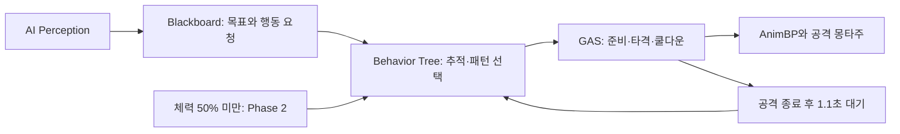

# 쌍검 수문장

`Warden_Boss`는 TestRoom 보스방에 한 마리 등장하는 2페이즈 보스다. 기존 프로젝트의 Paragon Minions 메시와 쌍검 보스 애니메이션을 재사용했다. 체력 1600, 공격력 18, 방어력 8, 처치 경험치 100이며 수치는 초기 밸런스다.

| 페이즈 | 선택 거리 | 패턴 | 준비 시간 | 쿨다운 |
|---|---|---|---|---|
| 1 | 0~300cm | 교차 베기: 정면 두 번 타격, 타격 간격 0.4초 | 0.6초 | 3.2초 |
| 1 | 300~800cm | 돌진: 전방 500cm 이동 후 도착 지점 타격 | 0.85초 | 5.5초 |
| 2 | 0~360cm | 원형 강타: 주변 360cm에 한 번 피해와 충격 효과 | 0.9초 | 4초 |
| 2 | 360~1300cm | 황혼의 검기: 부채꼴 투사체 5발 | 0.75초 | 3.5초 |

체력이 50% 미만이 되면 2페이즈로 전환하며 전투 종료까지 유지한다. 공격 방향을 먼저 맞추고 이동을 멈춘 뒤 공격한다. 공격이 끝나면 Behavior Tree의 Wait 태스크로 1.1초 동안 회복 동작 시간을 둔다. 사용할 패턴이 없으면 목표에 접근한다. 준비 동작은 몽타주로 표현하며 별도의 바닥 위험 범위 표시는 구현하지 않았다.

## Unreal 시스템 구성

- **AIController와 AI Perception**: 플레이어 감지와 목표 추적.
- **Behavior Tree** `BT_WardenBoss`: 목표·시야·페이즈·거리·쿨다운에 따라 행동 선택. 전용 트리를 복제하고 조건·스킬·회복 시간·노드 이름을 설정했다.
- **Blackboard** `BB_WardenBoss`: 목표 액터, 마지막 위치, 실행할 스킬 요청 등을 공유한다.
- **GAS**: `UDiaGameplayAbility`와 순차 Step으로 공격을 실행하고 피해·쿨다운을 처리한다. 신규 스킬 ID는 3201~3204다.
- **Animation Blueprint 상태머신**: 기존 `BP_DualBladeAnimInstance`의 Locomotion 상태머신이 Idle/Move를 전환한다. 공격은 보스 전용 몽타주 4개로 재생한다.
- **페이즈 상태**: C++의 체력 판정으로 Phase를 전환하고 BT의 `CheckPhase` 조건에서 읽는다. 별도의 StateTree는 사용하지 않는다.

## 저장 위치와 변경 범위

에셋은 `/Game/Blueprint/Monster/Boss/Warden` 아래에 있다. Blueprint 3개, Behavior Tree 1개, Blackboard 1개, 몽타주 4개를 만들었다. 스킬·몬스터 테이블에 새 행을 추가하고 `DT_SpawnGroupTable.NewRow_0`의 `TestRoomBoss` 몬스터 선택만 `Warden_Boss`로 바꿨다. 기존 `DualBlade_Boss`와 일반 몬스터의 데이터·에셋은 보존했다.

`warden.json`이 등록 설정이며 `prepare_warden_boss.py`와 `register_warden_boss.py`로 재현할 수 있다. 데이터 테이블 변경은 외부 클라이언트에서 개별 Unreal MCP 요청으로 실행한다. ProgrammaticToolset의 Undo 트랜잭션으로 테이블 쓰기를 감싸면 안 된다. 이전 장애 내용은 `../ElementalPack/crash-diagnosis.md`에 있다.

## 함께 수정한 실행 코드

- `DiaMonster.cpp`: 풀에서 몬스터를 다시 꺼내면 Phase·사망 상태·이전 처치자를 초기화한다.
- `DiaGameplayAbility.cpp/.h`: `StartDelay`를 GAS WaitDelay 태스크로 실행한다. 중단 시 대기 중인 후속 타격도 취소된다. Step 기반 스킬은 마지막 Step이 끝날 때 종료하여 애니메이션 종료가 후속 타격을 끊지 않게 했다.
- `DiaSkillStepExecutor.cpp`: 돌진이 충돌로 목표에 도달하지 못해도 종료 후 타격 단계로 진행한다. 취소된 스킬의 지연 콜백은 실행하지 않으며, 연속 Step의 종료 콜백을 덮어쓰지 않는다.

## 검증

- 최종 `ARPGEditor Win64 Development` 빌드 성공(19.24초).
- Blueprint 3개를 경고도 오류로 취급하여 컴파일하고 저장 속성을 재조회했다.
- 에셋 9개와 테이블 3개 저장 확인. PIE 종료 후 에디터에 `BT_WardenBoss`를 열어 두었다.
- 실제 보스방 진입 후 보스 생성과 1페이즈의 교차 베기 선택을 확인했다.
- GAS 피해를 적용해 체력을 1600에서 701로 낮춘 뒤, 실제 Phase 2와 거리별 원형 강타·검기 선택을 확인했다.
- 검기 5개 생성, 네 패턴의 피해, 돌진 약 492.81cm 이동 후 타격, 공격 종료를 확인했다.
- 연속 베기의 두 타격은 백그라운드 에디터의 낮은 프레임률에서 약 0.667초 간격으로 관측됐다. 중간에 몽타주를 끊은 시험에서는 첫 타격만 적용되고 후속 타격은 취소됐다.
- 처치 시 보스 체력 0, 풀 반환, 방 `CLEARED` 전환을 확인했다. 보상 선택이나 저장 슬롯 쓰기는 하지 않았다.
- 기록 기반 점검 20개 통과: `verification-result.json`. 실행 도구는 `verify_warden_results.py`다.

PIE 점검에서는 위치 이동, AI 일시 정지, 스킬 직접 발동과 AI에 의한 패턴 선택을 함께 사용했다. 플레이 감각과 여러 지형에서의 밸런스 검증은 별도 수동 플레이가 필요하다.
